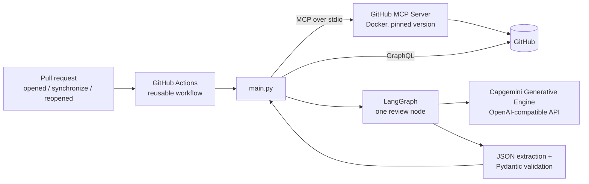

# AI Code Review Agent

A reusable, AI-powered Pull Request reviewer. When a pull request is opened or updated,
GitHub Actions runs this agent. The agent reads the PR through the official
**GitHub MCP Server**. It asks the **Capgemini Generative Engine** to review the changes
for **security, coding standards, tests and performance**. It validates the answer with
**Pydantic** and posts a summary review plus inline comments back to the pull request.

The agent only *suggests*. It never modifies code, approves, blocks or merges a pull
request. Every review is posted as a `COMMENT` review, and the merge decision stays with
people.

## Contents

- [How it works](#how-it-works)
- [Review lifecycle: duplicates, outdated and reopened threads](#review-lifecycle-duplicates-outdated-and-reopened-threads)
- [Technology stack](#technology-stack)
- [Project structure](#project-structure)
- [Use it from another repository](#use-it-from-another-repository)
- [Configuration](#configuration)
- [Local development](#local-development)
- [Testing and linting](#testing-and-linting)
- [Security](#security)
- [Limitations and future improvements](#limitations-and-future-improvements)

## How it works



Execution flow of one run (`main.py` → `run_review`):

1. **Fetch the pull request** (`GitHubMCPClient.fetch_pull_request`). The agent reads the
   PR details and every changed file, with its patch, through the MCP tool
   `pull_request_read` (`get`, then `get_files` page by page). The full `get_diff` is only
   requested when the server returns no per-file patches.
2. **Build the review context** (`src/context_builder.py`). The context holds the PR
   title, author, branches and description, followed by each patch exactly once. Every
   diff line is prefixed with its new-file line number, so the model can cite lines that
   can carry an inline comment. When the context exceeds `MAX_REVIEW_CONTEXT_CHARS`, it is
   cut only between hunks, and the files left out are listed.
3. **Review** (`src/graph.py`, `src/reviewer.py`). A LangGraph graph
   (`START → review → END`) makes one model call covering all four categories. The model
   must return JSON. The agent extracts the JSON, normalises every untrusted field and
   validates it with Pydantic. If the JSON is malformed or cut off, one repair call is
   made. If that also fails, the run stops instead of posting incomplete findings.
4. **Load existing review threads** with GitHub GraphQL. If GraphQL fails, the agent
   falls back to the MCP tool `get_review_comments`. If neither works, the run fails
   rather than risk duplicate comments. GraphQL also reports which account the token
   belongs to (`viewer.login`). Without it, thread ownership cannot be verified, so steps
   5 and 6 are skipped with a warning.
5. **Resolve outdated AI threads.** These are threads the agent itself started that
   GitHub marks as outdated (`resolveReviewThread`).
6. **Optionally reopen** resolved AI threads whose finding was reported again
   (`unresolveReviewThread`, off by default).
7. **Plan the review** (`plan_review`). Each finding becomes one of three kinds:
   - **inline**: the file and line are part of the PR diff;
   - **summary-only**: the finding has no line, or its line or file is not in the diff;
   - **duplicate**: the finding was already reported. Duplicates are skipped.
8. **Publish.** The agent creates a pending review, adds the inline comments, and submits
   it as a `COMMENT` review whose summary lists all new findings. If submitting fails,
   the agent deletes its own pending review, because GitHub allows only one pending
   review per user and pull request, and a leftover would block later runs. It never
   deletes a pending review it did not create.
9. **Exit code.** If a write operation fails (resolving or reopening a thread, creating
   or submitting the review, or an inline comment), the process exits non-zero, so the
   Actions job is red instead of falsely green. Read-only problems that the agent can
   work around, such as failing to load earlier reviews, are logged as warnings.

### Review categories

| Category | What the model looks for |
|---|---|
| Security | Injection, authn/authz flaws, secret exposure, unsafe deserialization, path traversal, command execution, weak cryptography, unsafe handling of untrusted input |
| Standards | Logic bugs, wrong conditions and boundaries, error handling, duplication, complexity, naming, maintainability |
| Tests | New or changed behaviour without tests, missing negative and boundary cases |
| Performance | N+1 access, repeated network calls, O(n²) work, expensive work in loops, excessive memory |

Each finding has `category`, `severity` (critical/high/medium/low/info), `file`,
`line`, `title`, `description`, `recommendation` and `confidence` (`src/schemas.py`).

## Review lifecycle: duplicates, outdated and reopened threads

All comment formatting and parsing lives in `src/thread_resolver.py`, so the comment the
agent writes and the comment it reads back can never drift apart.

- **AI thread identification.** A thread belongs to the agent only if its *first*
  comment has the agent's format, **and** that comment's author is the account behind
  the token. The format is either a hidden `<!-- ai-review-agent:finding -->` marker, or
  the exact layout of comments posted by earlier versions: a first line
  `**SEVERITY — Category**` with a known severity and category, plus a
  `**Recommendation:**` line. Threads by anyone else are never resolved or reopened,
  even if they look like AI comments, and they do not hide the agent's findings as
  duplicates. If the token belongs to a person rather than a bot account, comments that
  person writes in exactly the agent's layout would count as the agent's. Use a
  dedicated bot account for the token to avoid this.
- **Inline duplicates.** A finding's key is `file:line:normalised title`. The
  description is deliberately left out, so a reworded finding still counts as the same
  one. A finding is a duplicate when an AI thread with the same key still sits on
  current code, whether that thread is open or resolved.
- **Outdated threads.** When a push changes the commented code, GitHub marks the thread
  *outdated*. The agent resolves it and may report the finding again on the new code.
  Threads are never resolved just because the latest LLM run did not repeat a finding,
  because LLM output is not deterministic.
- **Summary-only findings.** These are findings with no line, or whose line is not in
  the diff. Their fingerprint (`sha256(file::title)`) is embedded in the summary review
  as a hidden HTML comment, and those fingerprints are read back on later runs.
- **Reopening** (`REOPEN_RESOLVED_THREADS=true`). When a resolved, still-current AI
  thread is reported again, it is reopened instead of being silently skipped. The
  default (`false`) treats the resolution as a reviewer's decision.
- **Inline validation** (`src/diff_utils.py`). Inline comments are only posted on
  added or unchanged lines of the RIGHT side of the diff. Deleted files, binary files,
  lines outside the diff and files outside the PR all become summary-only. A finding on
  the old name of a renamed file is mapped to the new name.

## Technology stack

| Technology | Purpose |
|---|---|
| Python 3.12+ | Application |
| GitHub Actions (reusable workflow) | Runs the agent on pull request events |
| GitHub MCP Server (Docker, pinned `v2.0.3`) | Reads the PR and writes the review |
| GitHub GraphQL API | Review threads, earlier reviews, resolve/unresolve threads |
| LangChain (`langchain-openai`) | Client for the OpenAI-compatible Capgemini endpoint |
| LangGraph | Review workflow graph (currently one node) |
| Capgemini Generative Engine | LLM that performs the review |
| Pydantic | Validates the findings |
| httpx | GraphQL HTTP client |
| pytest, pytest-asyncio | Tests (all external services mocked) |
| Ruff | Linting and formatting |

## Project structure

```text
ai-review-agentt/
├── .github/workflows/
│   ├── reusable-ai-review.yml   # workflow other repositories call
│   └── ci.yml                   # lint + tests for this repository
├── src/
│   ├── config.py                # Settings loaded from environment variables
│   ├── context_builder.py       # PR context for the model (numbered patches, truncation)
│   ├── diff_utils.py            # patch parsing, inline-target validation
│   ├── formatter.py             # summary review Markdown
│   ├── graph.py                 # LangGraph workflow
│   ├── mcp_github.py            # GitHub MCP client + GraphQL calls
│   ├── prompts.py               # review and repair prompts
│   ├── reviewer.py              # LLM call, JSON extraction, normalisation
│   ├── schemas.py               # Pydantic models
│   └── thread_resolver.py       # comment format/parse, duplicates, thread selection
├── tests/                       # pytest suite (no network, Docker or LLM needed)
├── docs/
│   ├── LEARNING_GUIDE.md
│   └── INSTRUCTOR_VIVA.md
├── main.py                      # entry point
├── pyproject.toml               # metadata, Python version, pytest + ruff config
├── requirements.txt             # runtime dependencies
├── requirements-dev.txt         # + pytest, pytest-asyncio, ruff
└── .env.example                 # every supported environment variable
```

## Use it from another repository

The target repository only needs a small caller workflow, for example
`.github/workflows/ai-code-review.yml`:

```yaml
name: AI Code Review

on:
  pull_request:
    types: [opened, synchronize, reopened]

permissions:
  contents: read
  pull-requests: write

jobs:
  ai-review:
    uses: 7391997393/ai-review-agentt/.github/workflows/reusable-ai-review.yml@main
    with:
      cg_model: ${{ vars.CG_MODEL }}
      cg_base_url: ${{ vars.CG_BASE_URL }}
      agent_ref: main # keep equal to the @ref above
    secrets:
      cg_api_key: ${{ secrets.CG_API_KEY }}
      gh_pat: ${{ secrets.GH_PAT }}
```

Set this up in the target repository:

| Kind | Name | Value |
|---|---|---|
| Secret | `CG_API_KEY` | Capgemini Generative Engine API key |
| Secret | `GH_PAT` | Token with **Pull requests: read and write** and **Contents: read** on the target repository |
| Variable | `CG_MODEL` | e.g. `gpt-oss-120b` |
| Variable | `CG_BASE_URL` | Optional; empty means the Capgemini default |

Reusable workflow inputs:

| Input | Required | Default | Meaning |
|---|---|---|---|
| `cg_model` | yes | | Model name |
| `cg_base_url` | no | `""` | OpenAI-compatible base URL |
| `agent_ref` | no | `main` | Branch, tag or SHA of the agent code to run. GitHub gives a called workflow no reliable way to learn its own ref, so pass the same ref you use in `uses: …@<ref>`. Pin both to a release tag for stable behaviour. |
| `agent_repository` | no | `7391997393/ai-review-agentt` | Repository holding the agent code |
| `reopen_resolved_threads` | no | `false` | See [Review lifecycle](#review-lifecycle-duplicates-outdated-and-reopened-threads) |
| `log_level` | no | `INFO` | `DEBUG`, `INFO`, `WARNING`, `ERROR` |

The reusable workflow also:

- runs at most one review per pull request at a time (`concurrency`, no cancellation
  mid-post), with a 20-minute timeout;
- installs only the runtime requirements and starts the pinned MCP server image;
- fails with a clear error when `cg_api_key` or `gh_pat` is missing.

### Pull requests from forks

GitHub does not pass repository secrets to workflows triggered by `pull_request` events
from forks. For those pull requests the workflow **does not run the review**. It
reports a warning annotation and writes "AI review not performed" to the job summary.
The check itself still shows as successful, so look at the summary or annotations
rather than the check colour alone. Dependabot pull requests are handled the same way,
unless `CG_API_KEY` and `GH_PAT` are also stored as Dependabot secrets. Do not switch
the caller to
`pull_request_target` to work around this unless you have assessed the security
implications for your repository.

## Configuration

Every setting comes from environment variables (`src/config.py`). See `.env.example`.

| Variable | Required | Default | Purpose |
|---|---|---|---|
| `CG_API_KEY` | yes | | Capgemini Generative Engine API key |
| `CG_MODEL` | yes | | Model name |
| `CG_BASE_URL` | no | Capgemini endpoint | OpenAI-compatible base URL |
| `CG_MAX_OUTPUT_TOKENS` | no | `8192` | Maximum tokens the model may generate |
| `GITHUB_TOKEN` (or `GH_PAT`, `GITHUB_PAT`) | yes | | GitHub token |
| `GITHUB_OWNER`, `GITHUB_REPO` | yes | | Target repository |
| `PR_NUMBER` | yes* | | Pull request number (*read from `GITHUB_EVENT_PATH` when unset) |
| `MAX_REVIEW_CONTEXT_CHARS` | no | `120000` | Size limit of the context sent to the model |
| `REOPEN_RESOLVED_THREADS` | no | `false` | Reopen resolved AI threads that are reported again |
| `GITHUB_MCP_COMMAND` | no | `docker` | `docker`, or the path of a local `github-mcp-server` binary |
| `GITHUB_MCP_IMAGE` | no | `ghcr.io/github/github-mcp-server:v2.0.3` | MCP server image |
| `LOG_LEVEL` | no | `INFO` | Log level |

## Local development

Requirements: Python 3.12 or newer. To run the agent against a real PR you also need
Docker (for the GitHub MCP Server) or a local `github-mcp-server` binary
(`GITHUB_MCP_COMMAND=/path/to/github-mcp-server`). The tests need neither.

```bash
git clone https://github.com/7391997393/ai-review-agentt.git
cd ai-review-agentt
python -m venv .venv
# Windows: .venv\Scripts\activate    macOS/Linux: source .venv/bin/activate
pip install -r requirements-dev.txt
cp .env.example .env    # Windows: copy .env.example .env
# fill in .env, then:
python main.py
```

Running `main.py` posts a real review to the configured pull request.

## Testing and linting

```bash
python -m pytest            # whole suite; GitHub, Docker and the LLM are mocked
ruff check .                # lint
ruff format --check .       # formatting
```

`.github/workflows/ci.yml` runs the same three checks on every push and pull request,
on Python 3.12 and 3.14.

## Security

- **Prompt injection.** Repository content is untrusted. The prompt marks the PR context
  as data, inside `<pull_request_context>` tags, and tells the model never to follow
  instructions found in it. The repair prompt treats the malformed answer the same way.
- **Model output is untrusted.** Fields are type-checked, clamped and length-limited.
  `@mentions` are neutralised and HTML comments are escaped, so a manipulated answer
  cannot ping people or forge the agent's hidden markers.
- **No PR code is executed.** The workflow checks out only the agent repository, never
  the pull request's code.
- **Secrets** come only from GitHub Actions secrets or a local, gitignored `.env`. Tokens
  are never logged. MCP responses are logged only as sizes, and the review body only at
  `DEBUG` level. Error messages can include up to 500 characters of the GitHub error
  response.
- **Least privilege.** The job has `contents: read` and `pull-requests: write`, the MCP
  server is limited to the `repos,pull_requests,issues` toolsets, and its image is pinned.
- **Only the agent's own threads are resolved or reopened.** Ownership is checked
  against the token's account, and nothing is resolved when that account is unknown.

## Limitations and future improvements

- A single LLM call reviews all four categories. Very large PRs are truncated, and the
  files left out are listed in the logs and in the context.
- The model's line numbers can still be wrong. Those findings are moved to the summary
  instead of failing.
- Up to 25 findings are kept per run.
- Duplicate detection matches findings by file, line and title. If the model words the
  title of the same issue differently on a later run, it can be posted again. The demo
  PR #6 in this repository shows three "Hard-coded password …" comments with different
  titles on one line.
- No static analysis yet. Combining Ruff/Bandit/CodeQL results with the LLM review is a
  natural next step.
- Ideas: separate graph nodes per category, repository-specific rules, configurable
  severity thresholds, an evaluation dataset to measure precision and recall, and
  release tags for the reusable workflow.

## License

No license file has been added yet, so all rights are reserved by default. Add a
`LICENSE` file before others reuse the code.
