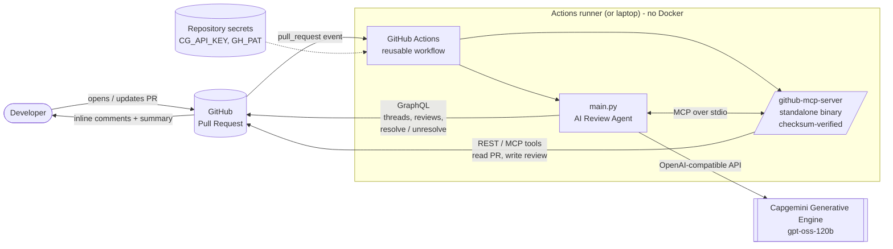
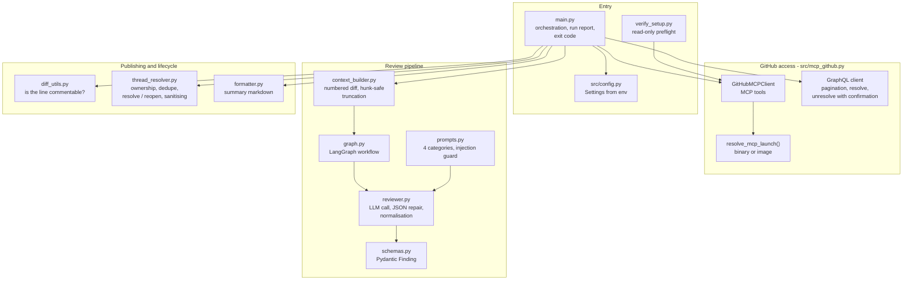
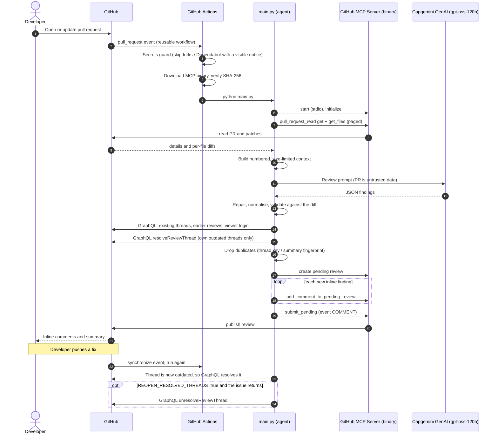

# Architecture

The agent runs as one Python process inside a GitHub Actions job (or on a laptop). It reads a
pull request through the **GitHub MCP Server**, asks the **Capgemini Generative Engine**
(`gpt-oss-120b`) for structured findings, validates them against the real diff, and publishes
one review. It also manages its own review threads through the **GitHub GraphQL API**.

The MCP server runs as a standalone executable started over stdio. No Docker is used.

## 1. System architecture

## 2. Component diagram

## 3. Sequence: from PR to resolved thread

## 4. Design decisions

| Decision | Reason |
|----------|--------|
| MCP for reading and writing the review, GraphQL for threads | MCP does not expose thread IDs or resolve; GraphQL gives exact IDs and confirms the result. |
| Standalone binary, SHA-256 verified | Meets the no-Docker policy and keeps the pinned, tested server version. |
| One LLM call, LangGraph with one node | Low cost and latency; the graph is the extension point for more stages. |
| Findings validated against the diff | Comments only land on lines GitHub accepts; the rest go to the summary. |
| Thread ownership by author | The agent never resolves or reopens a human's thread. |
| Exit code 1 when any GitHub write fails | CI shows failures instead of hiding them. |
